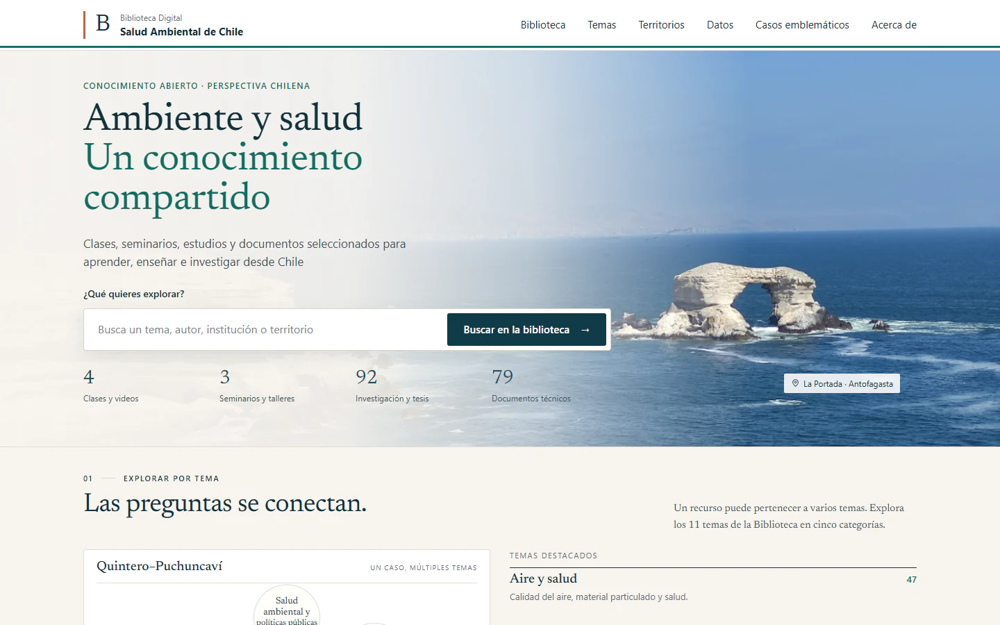

# Biblioteca Digital de Salud Ambiental de Chile

[English](README.md) · **Español**

**Conocimiento sobre salud ambiental, conectado con los territorios de Chile y las fuentes originales.**

Biblioteca digital que organiza clases, investigaciones y documentos técnicos públicos por tema, territorio y caso ambiental. Ayuda a encontrar un recurso, comprender su contexto y volver a la fuente original.

**Estado:** respaldo del MVP congelado el 19 de septiembre de 2026 para su presentación al Colegio Médico, según el registro original del repositorio. Esto no acredita respaldo institucional ni validación clínica. Se verificó la aplicación publicada en GitHub Pages; las capturas corresponden a ese despliegue real.

[Abrir la biblioteca](https://pabloagar.github.io/biblioteca-salud-ambiental-web/) · [Ejecutar localmente](#ejecutar-localmente) · [Explorar los datos del catálogo](catalog.js)

<picture>
  <source media="(max-width: 600px)" srcset="assets/screenshots/inicio-mobile.webp">
  
</picture>

Aplicación publicada real, 22 de octubre de 2026. [Portada móvil](assets/screenshots/inicio-mobile.webp) · [Captura del catálogo](assets/screenshots/catalogo-desktop.webp) · [Procedencia de las capturas](assets/screenshots/README.md).

## El problema

El material de salud ambiental está distribuido entre organismos públicos, universidades y plataformas audiovisuales. Una lista de enlaces por sí sola dificulta conectar la evidencia con un territorio, una exposición o una pregunta práctica.

## Qué puedes explorar

- Buscar y filtrar el catálogo por texto, tema, formato y territorio.
- Consultar cruces temáticos, perfiles regionales y casos ambientales.
- Leer descripciones, atribución y contexto documental antes de abrir la fuente original.
- Explorar vistas de datos con sus propias fuentes y limitaciones.

## Evidencia inspeccionable

La [aplicación](app.js) y el [catálogo](catalog.js) están disponibles en el repositorio. La portada agrupa los recursos en clases y videos, seminarios y talleres, investigación y tesis, y documentos técnicos. Son conteos del catálogo, no métricas de audiencia ni de impacto.

Las capturas muestran la portada y el catálogo reales en una sesión nueva de GitHub Pages. Permiten inspeccionar la interfaz; no certifican la exhaustividad, vigencia ni calidad científica de cada recurso enlazado. Una respuesta accesible de un enlace no verifica su contenido.

## Mi aporte

**Dr. Pablo Aguirre Araya, médico en Arica, Chile.** Concepto, estructura editorial, arquitectura de información, organización del contenido y desarrollo de la plataforma, según los créditos de la sección «Acerca de» de la app, con un flujo iterativo apoyado por IA.

La biblioteca organiza metadatos, contexto y enlaces. La autoría y los derechos de los recursos originales permanecen en sus fuentes; este repositorio no concede derechos sobre material de terceros.

## Ejecutar localmente

Abrir `index.html` en el navegador o servir esta carpeta con un servidor HTTP estático. Por ejemplo, con Python 3 instalado:

```sh
python -m http.server 8000 --bind 127.0.0.1
```

Después, abrir [localhost:8000](http://127.0.0.1:8000/). No requiere compilación ni backend. Los enlaces a fuentes externas requieren conexión a internet.

## Tecnología y alcance

HTML, CSS y JavaScript del navegador, con catálogo y recursos de datos versionados. El repositorio conserva el respaldo `MVP_2026-09-19_COLMED`; la documentación y las capturas nuevas no modifican esa versión de la aplicación.

La biblioteca es un recurso educativo y documental. No entrega evaluación individual de exposición, diagnósticos ni recomendaciones clínicas. La disponibilidad y vigencia de los recursos requieren revisión periódica; esta actualización del portafolio no realizó una revalidación exhaustiva de las fuentes externas.

[Contacto](mailto:pablo.aguirre.araya@gmail.com)
