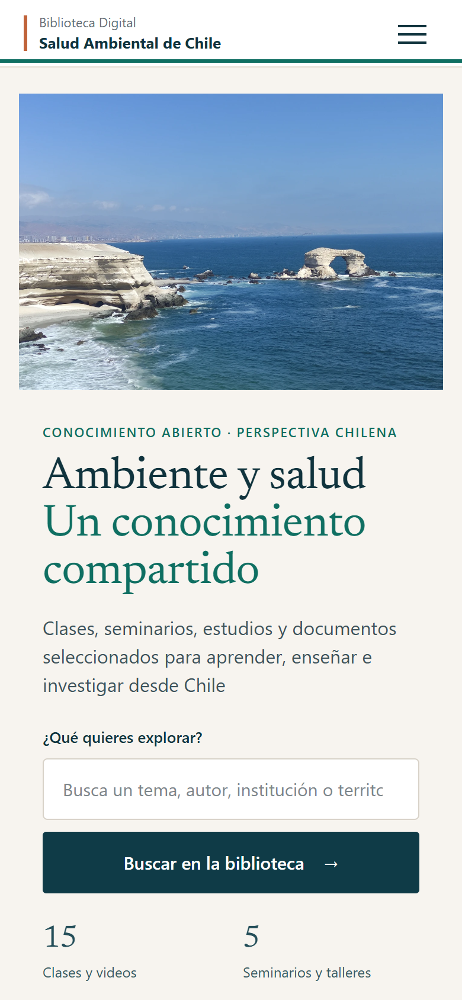
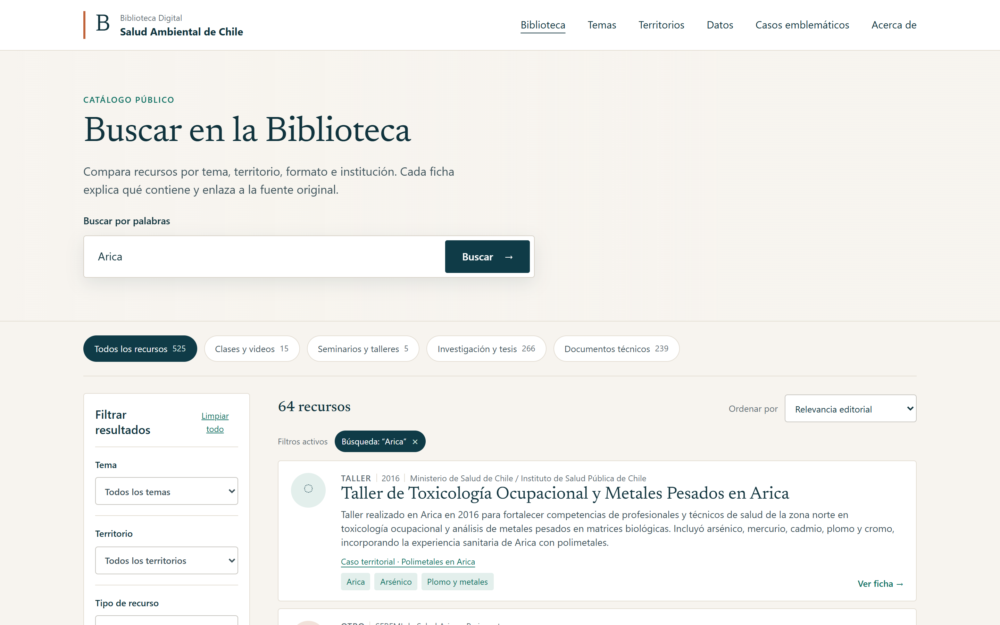

# Biblioteca Digital de Salud Ambiental de Chile

**English** · [Leer en español](README.es.md)

**A public starting point for environmental health knowledge in Chile.**

An MVP that brings together metadata and links to classes, seminars, research and technical documents. Designed to help students, health professionals, teachers and researchers find resources across topics and territories.

[Explore the public library](https://biblioteca-salud-ambiental-chile-pablo.pablo-aguirre.chatgpt.site) · [Browse resources](https://biblioteca-salud-ambiental-chile-pablo.pablo-aguirre.chatgpt.site/#catalogo)

**Public MVP.** This overview covers the public website and repository only.



*Real mobile capture, 390 × 844 CSS pixels. Spanish interface.*

## The problem and the experience

Relevant material is spread across institutions and formats. The library offers a common discovery interface while keeping each resource connected to its original source.

- Search by words and filter by topic, territory, resource type and institution.
- Explore topics, territorial cases and regional views.
- Read resource descriptions and follow source links.
- Browse classes, videos, seminars, research and technical documents on mobile or desktop.



*Desktop capture at 1440 × 900 CSS pixels. Counts describe the captured public catalog, not a permanent coverage guarantee. [Mobile results](assets/mobile-results.webp).*

## MVP status and institutional context

The [original repository note](docs/overview-before-visual-redesign.md) records an MVP frozen on September 19, 2026 for presentation to Colegio Médico. That note documents the presentation context; it does **not** establish institutional endorsement, certification or approval of the resources.

This repository is the public web snapshot. Internal development and unpublished changes are outside this presentation. Catalog descriptions and source availability need ongoing editorial review; inclusion does not establish evidence quality or clinical guidance.

## View locally

Download this public repository and open `index.html` in a modern browser, or serve the folder as a static site:

```sh
python -m http.server 8000
```

Then open `http://localhost:8000`. There is no build step. The public interface uses HTML, CSS and JavaScript with catalog metadata in `catalog.js`. External sources and videos require an internet connection and remain subject to their owners' availability and rights.

## My contribution

Problem framing, organization of the public discovery experience and interface decisions, with AI-assisted development. **Pablo Aguirre Araya, physician in Chile.**

[Explore the library](https://biblioteca-salud-ambiental-chile-pablo.pablo-aguirre.chatgpt.site) · [Contact](mailto:pablo.aguirre.araya@gmail.com) · [Capture details](docs/screenshots.md)
